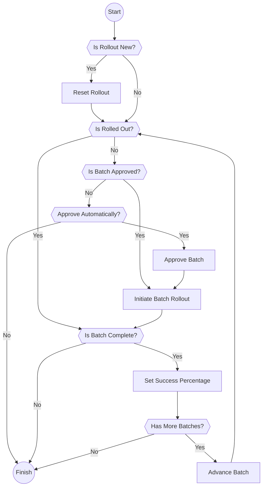

# Rollout device selection
The rollout device selection is implemented as periodic reconciler that is invoked by the periodic server.

The rollout device selection enables controlled, batch-based updates across device fleets. It works in conjunction with
the disruption budget to ensure safe and manageable rollouts.

Prerequisites:
- Fleet must have a defined rollout policy with device selection criteria
- Devices must be identified as out-of-date compared to the fleet's device specification

The reconciler processes fleets that meet these criteria and manages the progression of updates through defined batches.

The following chart describes a fleet reconcile flow:

## Persisting rollout progress

Fleet rollout commits each device's spec, template-version annotation, and resolved
fleet dependency references in one device mutation. The mutation checks the current
owner on every attempt. An ownership conflict leaves the new owner's references intact.
A reference-write failure rolls back the spec and template marker, so the device remains
eligible for a later rollout. Replacing references also removes entries left by a former fleet.

Device rendering checks the generation used to compute output inside the rendered-write
mutation. If the generation changed, the write returns a conflict and preserves the
current rendered output and validity conditions. Firmware-status-only events can reconcile
a hold immediately; events that also change the spec still honor render preparation delays.
