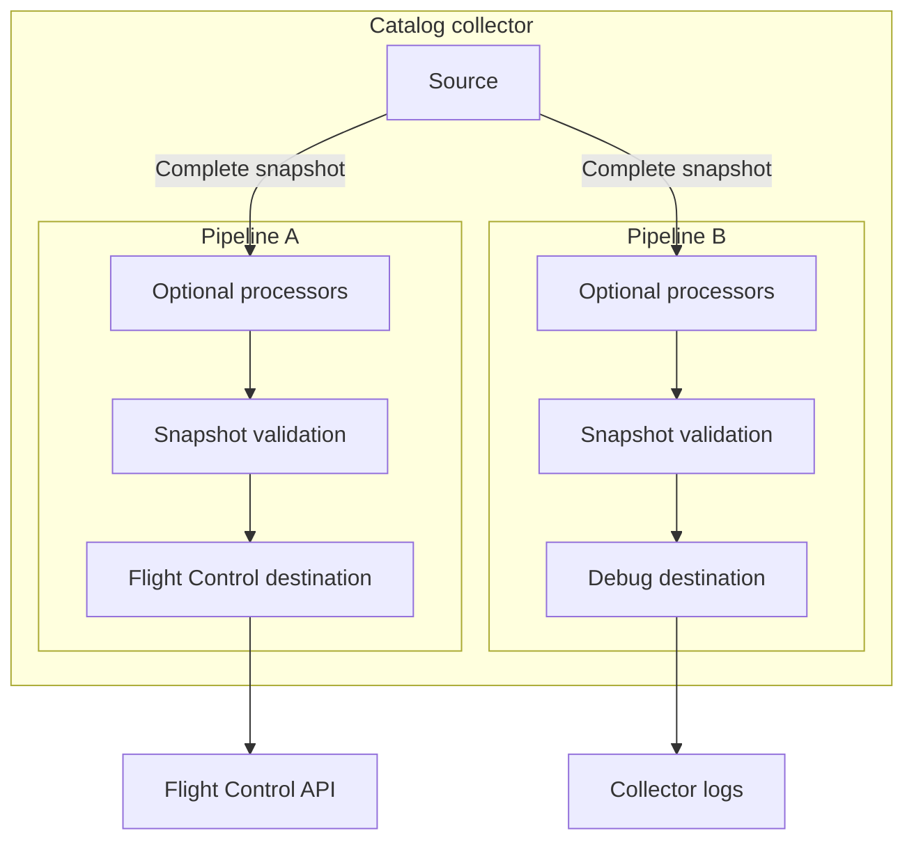

# Catalog collector overview

The Flight Control catalog collector is a standalone service that imports catalog metadata into Flight Control from an external platform that already maintains it. It imports the descriptive record of each component, the versions that exist, and the artifact references those versions resolve to.

> [!NOTE]
> The collector does not copy artifacts. Devices pull them from the registries that host them.

Use the collector when the authoritative list of deployable content lives somewhere other than Flight Control, for example in a model registry or an internal product catalog.

## What the collector does

The collector runs outside the Flight Control service as its own container or systemd unit. Each cycle moves one snapshot through three stages:

1. A *source* supplies the complete desired catalog content.
2. Zero or more *processors* transform that content, for example by renaming a catalog.
3. A *destination* consumes the result. The `flightctl` destination reconciles it into a Flight Control service; the `debug` destination only logs it.

The unit of work is a **catalog snapshot**: the complete set of Catalog and CatalogItem resources that the source's scope should contain, observed at one point in time, together with a revision identifier. A source either emits a complete catalog snapshot or emits nothing and reports an error. The rest of this documentation shortens the term to **snapshot**.

## Choosing between the collector and ResourceSync

Flight Control offers two ways to populate a catalog from outside the API, and a single deployment can use both for different catalogs. Use ResourceSync when you author the catalog content yourself and want Git review and history. Use the collector when another system already owns the content and Flight Control only has to track it.

The two also differ in how strongly the imported content is protected. ResourceSync marks each resource with an owner that the API enforces, while the collector labels are a boundary the collector applies to itself. For the side-by-side comparison, see [Importing catalogs from external sources](../managing-catalogs.md#importing-catalogs-from-external-sources).

## Data flow

A source supplies complete catalog snapshots to each pipeline that references it. Within each pipeline, optional processors run in the configured order. The collector validates the resulting snapshot before passing it to the destination.

The following example shows two pipelines sharing one source. One synchronizes catalog resources with Flight Control; the other logs snapshots:



Each pipeline references one source and one destination. Sources and destinations can be built-in components or custom components included in a custom collector build.

## Configuration model

The collector reads one YAML file, supplied with `--config`. The file declares component instances and connects them through pipelines. The following outline shows its top-level sections:

```yaml
service:        # process-wide settings: log level, metrics endpoint
extensions:     # shared capabilities: health endpoint, authenticators
sources:        # where catalog content comes from
processors:     # optional transformations
destinations:   # where catalog content goes
pipelines:      # source -> [processors] -> destination
```

The configuration model is inspired by the [OpenTelemetry Collector](https://opentelemetry.io/docs/collector/configuration/): it uses named components, pipelines, and extensions.

The catalog collector has its own configuration schema and component implementations. OpenTelemetry components cannot be loaded into it.

### Component identifiers

Each entry under `sources`, `processors`, `destinations`, and `extensions` uses a component identifier in the form `type[/name]`.

For example, the built-in HTTP snapshot source can use either of these identifiers:

* `http`: The HTTP snapshot source without an instance name.
* `http/snapshots`: An instance of the HTTP snapshot source named `snapshots`.

The type selects the implementation. The optional name lets you configure multiple instances of the same type. Each identifier must be unique within its configuration section.

### Pipelines

A pipeline references one source, an optional ordered list of processors, and one destination. For example:

```yaml
pipelines:
  external-catalog:
    source: http/snapshots
    processors:
      - catalogname/rename
    destination: flightctl/service
```

Define each referenced component in its corresponding configuration section. The configuration must define at least one pipeline.

Several pipelines may share a source; each snapshot is delivered to every pipeline using that source. Several pipelines may also share a destination.

The Flight Control destination uses collector labels to identify the resources managed by each pipeline. It updates or deletes existing resources only within that pipeline's management scope.

### Activating components

Sources, processors, and destinations are activated only when a pipeline references them. Components declared in the configuration but unused by any pipeline remain inactive.

Extensions, such as health checks and authentication, start whenever they are configured under `extensions`; they do not need to be referenced by a pipeline.

### Environment variables

You can use `${env:NAME}` or `${NAME}` to read a string value from the collector's environment. For example:

```yaml
destinations:
  flightctl/service:
    server: ${env:FLIGHTCTL_SERVER}
```

Set `FLIGHTCTL_SERVER` in the collector's environment to the complete API URL, such as `https://flightctl.example.com`.

The following rules apply:

* A reference must replace the whole value. Expressions such as `https://${env:HOST}` are not expanded.
* References are supported inside component configurations under `sources`, `processors`, `destinations`, and `extensions`. They are not expanded under `service` or `pipelines`.
* An unset variable in an active component stops startup with an error naming the variable and its configuration field.

For the complete rules, see [Environment variable references](../../references/catalog-collector.md#environment-variable-references).

## Pipeline components

A source supplies catalog snapshots to a pipeline. Processors can transform their content, and a destination receives the validated result.

### Built-in sources

| Source | How it obtains content | Use it for |
|---|---|---|
| `kubeflowmodelregistry` | Polls a Kubeflow Model Registry and converts model metadata into catalog resources. | Importing model metadata from Kubeflow Model Registry, including instances running in Red Hat OpenShift AI. |
| `http` | Accepts complete snapshots posted to an HTTP endpoint. | Receiving content from an external adapter or submitting snapshots manually for testing. |

For the Model Registry workflow and configuration, see [Importing a Kubeflow Model Registry](kubeflow-model-registry.md).

> [!WARNING]
> The `http` source does not authenticate incoming requests. Clients that can reach it can submit snapshots that change or delete resources managed by pipelines using the Flight Control destination.
>
> Bind the endpoint to loopback for local use. For remote access, restrict network access and use an authenticating proxy with TLS.

### Built-in processors

The built-in `catalogname` processor renames Catalog resources using configured mappings and updates the corresponding `CatalogItem.metadata.catalog` references.

Use it to map source catalog names to the names you want to use in Flight Control.

### Built-in destinations

| Destination | What it does | Use it for |
|---|---|---|
| `flightctl` | Creates and updates Catalog and CatalogItem resources in Flight Control and removes pipeline-managed resources omitted from the desired snapshot. | Keeping Flight Control catalogs synchronized with source content. |
| `debug` | Logs snapshots at the configured verbosity. | Inspecting snapshot content and testing pipelines. |

For built-in component settings, see the [Catalog collector configuration reference](../../references/catalog-collector.md).

### Custom integrations

You can integrate other platforms in the following ways:

* **External adapter:** Run a separate program that reads an external platform, maps its content to Catalog and CatalogItem resources, and posts complete snapshots to the built-in `http` source. The adapter can use any programming language and be deployed independently of the collector.
* **Custom source:** Implement a source component and register it in a custom collector build. The component runs inside the collector process and supplies snapshots to its pipelines.
* **Custom destination:** Implement a destination component and register it in a custom collector build. The component receives snapshots and implements the required output or reconciliation behavior.

For a source implementation example and custom collector build instructions, see [Extending the catalog collector](../../../developer/extending-catalog-collector.md).

## Snapshot format

A snapshot represents the complete desired catalog content within a source's configured scope. All sources produce the same snapshot structure:

| Part | Description |
|---|---|
| Revision | A non-empty, deterministic identifier of the desired content. It changes only when that content changes. |
| Catalogs | The desired Catalog resources. |
| Catalog items | The desired CatalogItem resources. |

After any configured processors have run, the collector validates the snapshot before passing it to the destination:

* The revision must be non-empty.
* Each Catalog and CatalogItem must pass resource validation.
* Catalog names must be unique within the snapshot.
* Each CatalogItem must specify a catalog and a name. That combination must be unique within the snapshot.

> [!WARNING]
> The Flight Control destination attempts to delete pipeline-managed resources omitted from a snapshot. A snapshot with no Catalogs and no CatalogItems requests deletion of all resources managed by that pipeline.
>
> Each snapshot must include the complete desired content for the source's configured scope.

The following JSON illustrates a snapshot containing one catalog and one catalog item. The example uses a stable upstream content revision:

```json
{
  "revision": "registry-revision-42",
  "catalogs": [
    {
      "apiVersion": "flightctl.io/v1alpha1",
      "kind": "Catalog",
      "metadata": {
        "name": "ai-models"
      },
      "spec": {
        "displayName": "AI Models",
        "shortDescription": "Models imported from the example registry"
      }
    }
  ],
  "catalogItems": [
    {
      "apiVersion": "flightctl.io/v1alpha1",
      "kind": "CatalogItem",
      "metadata": {
        "name": "object-detector",
        "catalog": "ai-models"
      },
      "spec": {
        "type": "data",
        "category": "application",
        "displayName": "Object Detector",
        "shortDescription": "Vision model for edge inference",
        "provider": "example-team",
        "artifacts": [
          {
            "type": "container",
            "uri": "quay.io/example/object-detector"
          }
        ],
        "versions": [
          {
            "version": "1.0.0",
            "references": {
              "container": "sha256:0f3a1ad6b4a2c5f2b2c8ef7e4d5a6b7c8d9e0f1a2b3c4d5e6f7a8b9c0d1e2f3a"
            }
          }
        ]
      }
    }
  ]
}
```

For Catalog and CatalogItem fields, see [Software catalog](../managing-catalogs.md). For HTTP request requirements and response codes, see [HTTP source](../../references/catalog-collector.md#http).

## Installation and examples

For Kubernetes, OpenShift, and standalone Linux installation procedures, see [Installing the catalog collector](../../installing/installing-catalog-collector.md).

The Helm chart and RPM package include example configurations. Their deployment-specific READMEs describe how to run the examples.

For an end-to-end Model Registry integration, see [Importing a Kubeflow Model Registry](kubeflow-model-registry.md).

## Synchronizing with Flight Control

The behavior in this section applies to pipelines using the `flightctl` destination. Other destinations implement their own output behavior.

The Flight Control destination synchronizes Catalog and CatalogItem resources with the desired content in each snapshot:

* It creates missing resources and updates resources whose specifications or labels differ from the desired content.
* It uses collector labels to identify the resources managed by each pipeline.
* It refuses to take over existing resources outside that pipeline's management scope, including resources managed by another pipeline or owned by ResourceSync.
* It attempts to delete pipeline-managed resources omitted from the snapshot.

The destination adds its management labels automatically. Snapshots sent to it must not set those reserved labels.

### Manual changes

Authorized clients can edit collector-managed resources through the Flight Control API. While the management labels remain intact, the next successful synchronization restores the specifications and labels supplied by the pipeline.

Make changes to imported catalog specifications in the source system. Removing management labels from a resource takes it outside the pipeline's management scope and can cause a name collision during subsequent synchronization.

### Deletion and synchronization failures

The Flight Control API rejects deletion of a CatalogItem while a device or fleet references one of its versions. Remove those references before the pipeline can delete the item.

Synchronization applies changes one resource at a time. If an operation fails, earlier changes remain applied. A later successful synchronization can complete the remaining changes.

> [!IMPORTANT]
> Keep pipeline IDs stable. Renaming a pipeline leaves existing resources associated with the old ID. The renamed pipeline cannot take over those resources and can fail with name collisions.

For management labels, reconciliation rules, authentication, and required permissions, see [Flight Control destination](../../references/catalog-collector.md#flightctl).

## Operating the collector

### Startup and readiness

The collector validates its configuration and starts configured extensions. It then runs startup preflight checks for sources and destinations that implement them.

Destination preflight checks run before source preflight checks. These checks complete before sources start and the collector reports ready. A failed check stops startup and is reported in the collector logs.

Preflight behavior depends on the component. For example, the Flight Control destination checks connectivity, authentication, and permission to list Catalogs and CatalogItems. It does not verify create, update, or delete permissions.

Readiness confirms that startup completed and any implemented preflight checks passed. Collection, processing, and synchronization can still fail during operation.

Use metrics and logs to confirm successful pipeline activity. For pipelines using the Flight Control destination, also verify the resulting resources with the Flight Control CLI.

### Health endpoints

When configured, the `healthcheck` extension exposes liveness and readiness endpoints:

| Endpoint | Meaning |
|---|---|
| Liveness, `/livez` by default | Returns `200 OK` while the health server is running. |
| Readiness, `/readyz` by default | Returns `503 Service Unavailable` during startup and shutdown, and `200 OK` after startup completes. |

The endpoint address and paths are configurable. See [Health check extension](../../references/catalog-collector.md#healthcheck).

### Metrics

When `service.metrics` is configured, the collector exposes Prometheus metrics at `/metrics` on the configured address.

The exported series use the prefix `flightctl_catalogcollector_`. They cover source collection, pipeline synchronization, durations, and resource counts.

For metric names and labels, see [Metrics](../../references/catalog-collector.md#metrics). For commands to check readiness, metrics, and synchronized resources, see [Verifying the installation](../../installing/installing-catalog-collector.md#verifying-the-installation).

### Applying configuration changes

The collector reads its configuration at startup. Restart it after changing the configuration.

Credential-file rotation follows the behavior of the configured authentication extension. Bearer-token files are read on every outgoing request. OAuth2 client-credential files are read when a new access token is acquired.

For credential settings and rotation behavior, see [Bearer token authentication](../../references/catalog-collector.md#bearertokenauth) and [OAuth2 client authentication](../../references/catalog-collector.md#oauth2client).

For deployment-specific restart procedures, see [Installing the catalog collector](../../installing/installing-catalog-collector.md).

## Troubleshooting

### Inspecting source snapshots

Use the `debug` destination to log snapshots for inspection. The following configuration fragment adds an inspection pipeline for an already configured `http/snapshots` source:

```yaml
destinations:
  debug/stdout:
    verbosity: normal

pipelines:
  inspect-snapshots:
    source: http/snapshots
    destination: debug/stdout
```

The available verbosity levels are:

* `basic`: Logs the revision and resource counts.
* `normal`: Also logs catalog names and catalog item identities.
* `detailed`: Logs the full JSON representation of each resource.

> [!WARNING]
> Detailed output writes the full content of every catalog resource to the collector log, where any system that collects those logs can read it. This content may include internal hostnames, registry paths, and other sensitive operational information. Use `basic` or `normal` in production, and limit `detailed` to short, supervised troubleshooting sessions.

For configuration settings, see [Debug destination](../../references/catalog-collector.md#debug). For HTTP request requirements and response codes, see [HTTP source](../../references/catalog-collector.md#http).

### Common failures

| Symptom | What to check |
|---|---|
| Startup fails with a configuration path in the error | Check for misspelled or unknown fields and unset environment variables. |
| Startup preflight fails | Check the component's endpoint, credentials, TLS settings, and required permissions. Follow any component-specific validation details in the log. |
| The collector is ready, but the pipeline has no successful synchronizations | Confirm that the source is producing snapshots. Inspect collection and pipeline metrics and logs for failures. |
| Flight Control synchronization fails with a name collision | Check whether the existing resource belongs to another pipeline, is owned by ResourceSync, or lacks the expected management labels. |
| Flight Control synchronization fails after a pipeline rename | Existing resources still carry the old pipeline ID. See [Synchronizing with Flight Control](#synchronizing-with-flight-control). |
| A CatalogItem remains after being omitted from a snapshot | Check whether a device or fleet still references one of its versions. The API conflict identifies the affected versions. |
| Only some Flight Control resources changed before synchronization failed | Earlier operations remain applied. Resolve the reported failure and allow or submit another complete snapshot. |

## Further reading

* [Installing the catalog collector](../../installing/installing-catalog-collector.md)
* [Importing a Kubeflow Model Registry](kubeflow-model-registry.md)
* [Catalog collector configuration reference](../../references/catalog-collector.md)
* [Software catalog](../managing-catalogs.md)
* [Extending the catalog collector](../../../developer/extending-catalog-collector.md)
